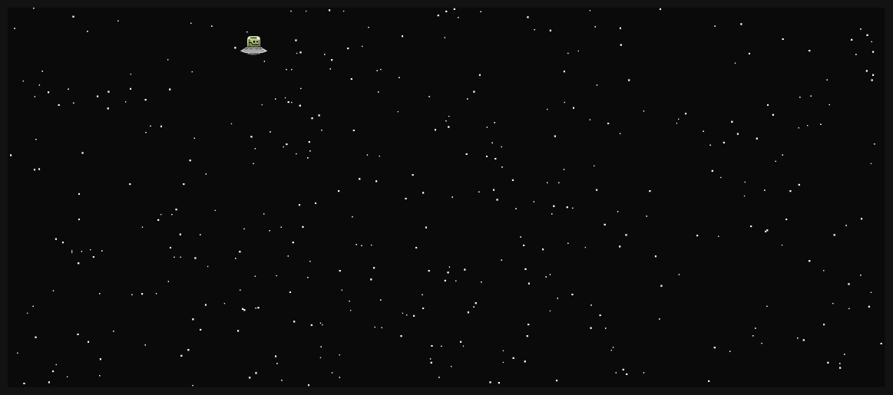

# Starfield UFO

Uma pequena animação desenvolvida com **HTML, CSS e JavaScript**, utilizando o elemento Canvas para simular um campo de estrelas em movimento, com aparições ocasionais de UFOs.

## Funcionalidades

- Estrelas com posições, tamanhos e velocidades aleatórias.
- Movimento contínuo das estrelas pelo canvas.
- Aparições periódicas e aleatórias de UFOs.
- Movimento independente dos UFOs, que atravessam a tela e desaparecem ao sair do canvas.

## Tecnologias utilizadas

- HTML5
- CSS3
- JavaScript
- Canvas API

## Como executar

1. Clone o repositório ou baixe os arquivos do projeto.
2. Certifique-se de que a imagem `ufo.png` esteja disponível no diretório `img/`.
3. Abra o arquivo `index.html` no navegador.

## Como funciona

A animação utiliza classes JavaScript para representar os elementos da cena:

- **`Star`**: representa uma estrela, controlando sua posição, tamanho, velocidade e movimento.
- **`Ufo`**: representa um UFO, controlando sua aparição, movimentação e desaparecimento.
- **`Scene`**: gerencia o canvas, a renderização dos objetos e a atualização da animação.

Os UFOs aparecem automaticamente em intervalos aleatórios, sem necessidade de interação do usuário, tornando suas aparições eventos ocasionais na animação.

## Objetivo

Projeto desenvolvido para praticar programação orientada a objetos em JavaScript, manipulação do Canvas API e criação de animações utilizando `requestAnimationFrame()`.